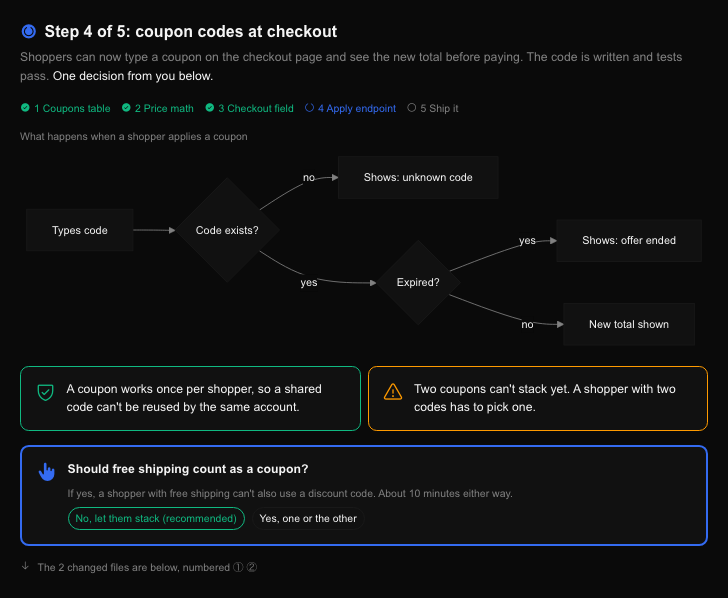

# show-me

An agent skill that answers visually inside [T3 Code](https://github.com/pingdotgg/t3code). Replies become small inline HTML renders: Phosphor icons, colors that always mean the same thing, card sections, and flowcharts when something flows. Code never goes inside the HTML. It stays in normal fenced blocks, linked to the render by numbered badges.



*Demo with a made-up project.*

## Install

Pick your agent. Claude Code, Codex, Antigravity and the `npx skills` route are tested; the rest follow each agent's documented format.

<details open>
<summary><strong>Claude Code</strong></summary>

```
/plugin marketplace add Dananz/show-me
/plugin install show-me@show-me
```

Run with `/show-me:show-me`. Updates: `/plugin` → Marketplaces → `show-me` → **Enable auto-update**, or `/plugin marketplace update show-me`.

</details>

<details>
<summary><strong>Codex</strong></summary>

```bash
codex plugin marketplace add Dananz/show-me --ref main
codex plugin add show-me@show-me
```

Run with `$show-me`. Updates: `codex plugin marketplace upgrade show-me`, then remove and add the plugin again.

</details>

<details>
<summary><strong>Antigravity (agy)</strong></summary>

```bash
agy plugin install https://github.com/Dananz/show-me
```

Updates: `agy plugin uninstall show-me`, then install again.

</details>

<details>
<summary><strong>Cursor, OpenCode, Pi, and any agent-skills harness</strong></summary>

```bash
npx skills add Dananz/show-me -g
```

Updates: `npx skills update -g`. Without the CLI, copy `skills/show-me` into the folder your agent scans for skills.

</details>

<details>
<summary><strong>Grok</strong> (untested)</summary>

```bash
grok plugin install Dananz/show-me --trust
grok plugin enable show-me
```

</details>

<details>
<summary><strong>Gemini CLI</strong> (untested)</summary>

```bash
gemini extensions install https://github.com/Dananz/show-me
```

The extension loads `GEMINI.md`, so visual mode is on in every session.

</details>

<details>
<summary><strong>Qwen Code</strong> (untested)</summary>

```bash
qwen extensions install Dananz/show-me
```

</details>

<details>
<summary><strong>Kimi Code</strong> (untested)</summary>

In a session: `/plugins` → **Custom** → paste `https://github.com/Dananz/show-me` → **Trust and install**. Run with `/skill:show-me`.

</details>

<details>
<summary><strong>Pi / Oh My Pi</strong> (untested)</summary>

```bash
pi install https://github.com/Dananz/show-me
```

```bash
omp plugin marketplace add Dananz/show-me
omp plugin install --scope user show-me@show-me
```

</details>

<details>
<summary><strong>Hermes</strong> (untested)</summary>

```bash
hermes skills install Dananz/show-me/skills/show-me
```

</details>

<details>
<summary><strong>GitHub Copilot</strong></summary>

```bash
npx skills add Dananz/show-me -a github-copilot -g
```

</details>

Then ask for something and say `show me`. It stays on for the session. Say `stop visual mode` to turn it off.

## What it does

- **Result first, then one plain sentence** of context, so someone who wasn't following still gets it.
- **Color means one thing:** green done, amber tradeoff, red broken, blue info. Theme variables only, so light and dark both work.
- **Flowcharts** for anything with order or branches (plain cards for linear steps, Mermaid for branches).
- **Asks look like asks:** a decision you need to make gets its own card with the options spelled out.
- **Code stays text:** T3 stacks every render above the reply, so code goes below in fenced blocks, matched to the render by ① ② ③.
- **Hebrew / RTL** support: `dir="rtl"`, flipped arrows, `RL` flowcharts.

Inspired by the [i-have-adhd](https://github.com/ayghri/i-have-adhd) skill for actionable, low-friction answers.

## Files

- `skills/show-me/SKILL.md`: the rules.
- `skills/show-me/template.html`: a starter render with cards, a linear flow, a progress row and a Mermaid chart.
- Per-agent manifests: `.claude-plugin/` (Claude Code, Grok, OMP), `plugin.json` (Codex, Antigravity), `.agents/plugins/marketplace.json` (Codex marketplace), `gemini-extension.json` + `GEMINI.md`, `qwen-extension.json`, `kimi.plugin.json`, `package.json` (Pi).

## Requirements

T3 Code with the `html_preview` and `html_render` tools. Elsewhere it falls back to markdown.

## License

MIT
